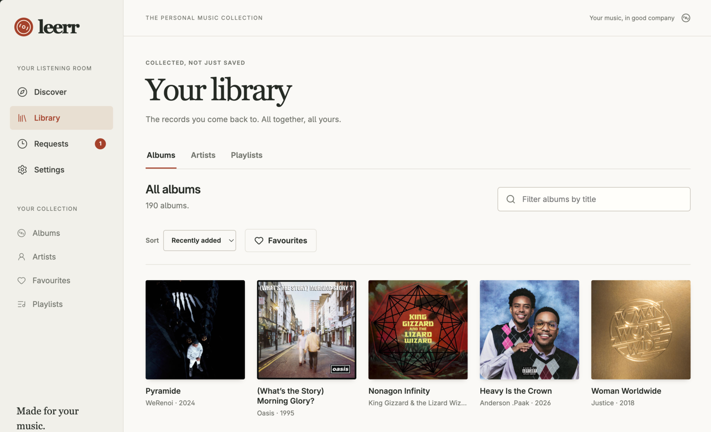
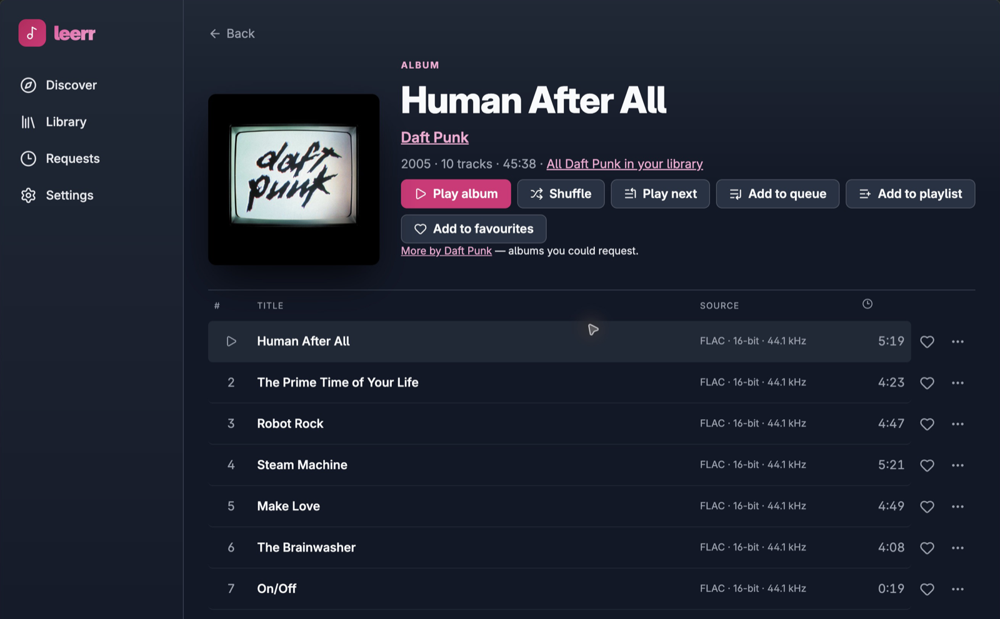
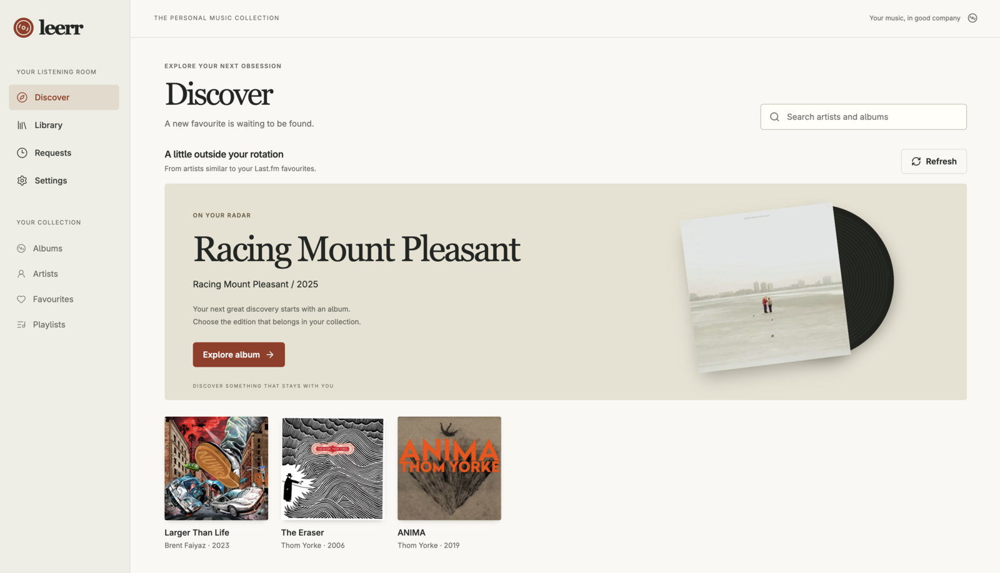
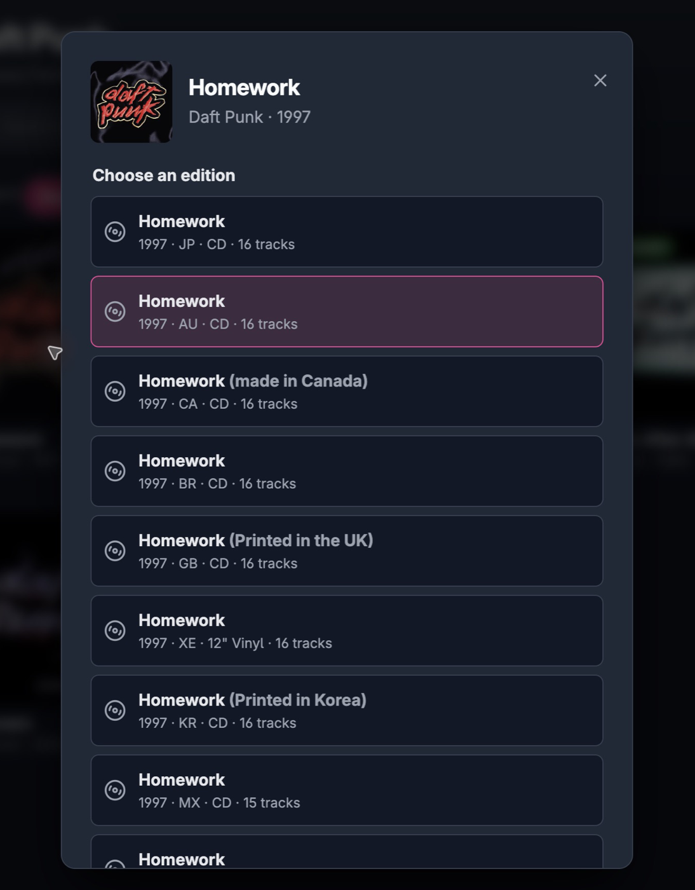
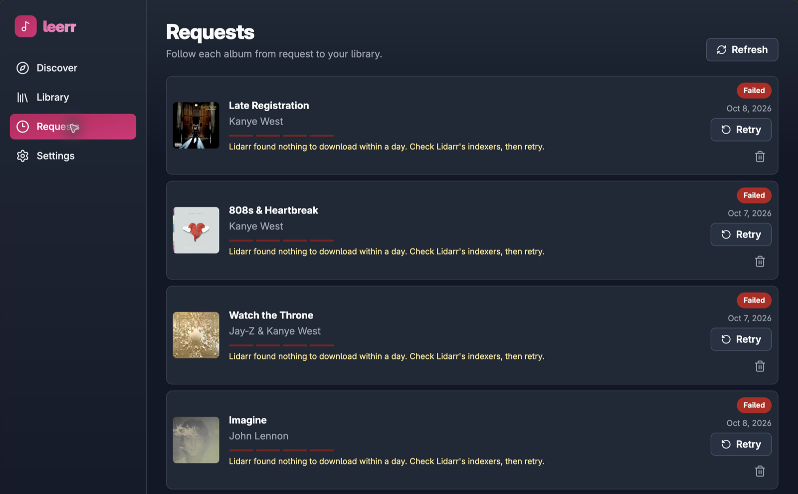

<p align="center">
  
</p>

<h1 align="center">Leerr</h1>

<p align="center"><strong>Discover albums. Request an edition. Play it from Plex.</strong></p>

<p align="center">A self-hosted music app for households and small groups sharing Plex and Lidarr.</p>

<p align="center">
  <a href="#try-the-demo">Try the demo</a> ·
  <a href="#self-host-with-docker">Self-host</a> ·
  <a href="#how-to-use-leerr">How to use it</a> ·
  <a href="docs/deployment.md">Deployment guide</a>
</p>



Leerr brings music discovery, album requests and browser playback into one place.
Find an album on MusicBrainz, choose the edition you want, and let Lidarr handle
the download. When it appears in Plex, listen right in Leerr.

Each person has their own Leerr account and links their own Plex account. Their
library follows Plex's permissions, and their favourites and playlists stay with
them in Plex and Plexamp. Managed Plex Home profiles are supported too.

## What you can do

- Search artists and albums, browse discographies by release type, and find new
  releases from artists already in your library.
- Get suggestions based on your Last.fm listening or the artists you own, with
  an optional Last.fm API key.
- Request a specific edition and follow its progress. Leerr keeps Lidarr on the
  chosen edition and shows when a request fails or needs attention.
- Stream your Plex music in the browser with a queue, play next, shuffle, repeat,
  favourites and playlists. Playback updates Plex's history and play counts.
- Use the app on a phone or desktop, and add it to your home screen.
- Send request notifications to ntfy, Discord or a JSON webhook.

Leerr runs as one Node.js process with one SQLite database. Docker Compose and a
Nix package are included; no separate database server is needed.

## A look inside

These screenshots come from a running self-hosted installation with a real Plex
music library.

Open an album to see its tracks, durations and audio quality, then play it, queue
it or add it to a playlist.



<details>
<summary>Discover albums from artists similar to your favourites</summary>

Discover features an album from artists similar to your Last.fm favourites, with
more suggestions below it. Open one to choose an edition and request it.



</details>

<details>
<summary>Compare editions before requesting an album</summary>

Choose between releases by country, year, format and track count. This is the
edition picker for Daft Punk's Homework.

<p align="center">
  
</p>

</details>

## Try the demo

You only need **Node.js 24+** and npm. No Plex or Lidarr setup is required.

```sh
git clone https://github.com/maximilianpw/leerr.git
cd leerr
npm ci
npm run preview
```

Open <http://localhost:3000> and sign in with:

| Username | Password |
| --- | --- |
| `preview` | `preview-password` |

Browse **Library**, open an album, or request **Coastal Lines** under **Discover**
and follow it in **Requests**. Playback uses a short test tone, not real songs.

The demo uses fake services and an in-memory database. Changes reset on restart,
and it refuses to save service credentials. Use the production setup below for
your own music.

## Self-host with Docker

### What you need

- Docker Engine with the Compose plugin, plus Git and Node.js 24+ for the commands below.
- An HTTPS reverse proxy, such as Caddy or nginx, in front of Leerr.
- A claimed Plex Media Server with a music library using the **Plex Music** agent,
  reachable from Leerr over HTTPS. Plex 1.43 has been tested.
- Lidarr 2 or newer for requests, reachable over HTTPS, with indexers, a download
  client and storage already configured. Lidarr 3.1 has been tested.
- A music folder that Lidarr can write to and Plex can scan.

Leerr manages requests; Lidarr handles acquisition and Plex serves your music.
Leerr also needs access to MusicBrainz and plex.tv. Last.fm is optional.

### 1. Get the source and create an encryption key

```sh
git clone https://github.com/maximilianpw/leerr.git
cd leerr

sudo install -d -m 700 /etc/leerr
node -e 'process.stdout.write(require("crypto").randomBytes(32).toString("base64"))' | sudo tee /etc/leerr/key >/dev/null
sudo chown 1000:1000 /etc/leerr/key
sudo chmod 600 /etc/leerr/key
```

Create the key once for a **new installation**. Keep it outside the checkout and
back it up separately from the database. An existing database needs its existing
key. For rootless Docker or Podman, follow the
[key ownership instructions](docs/deployment.md#configuration) instead.

### 2. Configure and start Leerr

```sh
cp .env.example .env
# Edit .env before starting.
docker compose up -d --build
```

Set these values in `.env`:

| Variable | What to set |
| --- | --- |
| `LEERR_ORIGIN` | The public HTTPS origin, such as `https://music.example.com`, with no path. |
| `LEERR_TRUST_PROXY` | Your reverse proxy's address as seen by Leerr. The default `10.213.47.1` fits a proxy on the Docker host. |
| `LEERR_KEY_FILE` | The absolute host path to your key, `/etc/leerr/key` in the example above. |

Compose builds the image locally, stores data in the `leerr_data` volume and
binds port 3000 to loopback. Run one instance of Leerr.

Point your HTTPS proxy at `127.0.0.1:3000` using the
[Caddy or nginx configuration](docs/deployment.md#reverse-proxy). Leerr requires
HTTPS in production, including the correct forwarded headers. The guide also
covers audio streaming and keeping playback credentials out of access logs.

### 3. Connect your services

Open your public HTTPS address. Retrieve the setup token and use it to create
the first administrator:

```sh
docker compose exec leerr cat /data/setup-token
```

1. In **Settings → Server**, save your Plex server's HTTPS address. Use its
   [plex.direct address](docs/deployment.md#plex) or your own HTTPS proxy.
2. Save the Lidarr HTTPS address and API key. Then choose its root folder,
   quality profile and metadata profile, and save again.
3. In **Settings → Connections**, choose **Sign in with Plex**. After linking,
   return to **Server** to select the music library if you have more than one.
4. In **Settings → Users**, add the people who will use Leerr. Each person links
   their own Plex account. An administrator can use **Link Plex profile** for a
   managed Home profile.
5. Configure [Plex scanning after imports](docs/deployment.md#plex), either
   through Lidarr's Plex connection or Plex's automatic library scanning.

Optionally add a Last.fm API key and a notification destination under **Server**.
A shared Last.fm key lets members connect using just their Last.fm username.

For private certificates, scheduled backups, native Node deployment and the full
configuration reference, see [Deployment and operations](docs/deployment.md).
For Nix, see the [Nix package guide](docs/nix.md).

## How to use Leerr

1. **Find an album.** Open **Discover**, search for an artist or album, or browse
   suggestions. Artist pages separate studio albums, EPs, live releases and
   compilations.
2. **Pick an edition.** Open an album, compare the listed dates, formats and
   track counts, then choose **Request this edition**. Requests for the same
   album share an acquisition; if someone requested another edition first,
   Leerr tells you that you'll share theirs.
3. **Follow progress.** Open **Requests** to see the status. Failed requests can
   be retried; an administrator handles requests marked **Needs attention**
   under **Settings → All requests**.
4. **Listen.** Once the album is in Plex, open it from **Requests** or **Library**
   and choose **Play album**. Use **Play next**, **Add to queue** or **Add to
   playlist** to choose what comes next. The queue button opens the track list
   for reordering and removal.
5. **Keep your favourites.** Use the heart on an album or track. Favourites map
   to Plex's five-star rating and are shared with Plexamp. Find your playlists
   under **Library → Playlists**.

FLAC, MP3, AAC, Opus, Vorbis and WAV stream in their original format. Plex converts
formats the browser cannot play, such as ALAC and AIFF, to MP3. This does not
require Plex Pass.

## Keeping it running

- Check **Settings → Status** for service connectivity, worker health and the
  most recent backup. For container logs, run `docker compose logs --tail=100 leerr`.
- Enable [scheduled backups](docs/deployment.md#backups), copy them off the host,
  and keep the matching encryption key separately. The database alone is not
  enough for recovery.
- Read the [changelog](CHANGELOG.md) and [upgrade guide](docs/deployment.md#upgrading)
  before updating. After backing up and checking out the version you want, run
  `docker compose up -d --build`. Leerr migrates its database on startup.

### Common setup questions

| Symptom | Where to look |
| --- | --- |
| "Leerr requires HTTPS" behind a working proxy | Check `LEERR_TRUST_PROXY` and the [forwarded headers](docs/deployment.md#reverse-proxy). |
| Plex reports a certificate name mismatch | Use the exact [plex.direct hostname](docs/deployment.md#plex), not an IP address or `localhost`. |
| An imported album has not appeared in Leerr | Check Plex scanning and matching. Leerr does not trigger Plex scans; see [Plex setup](docs/deployment.md#plex). |
| Requests wait, or EPs and live albums fail | Save Lidarr's root folder and profiles. Its metadata profile must allow the requested release type. |
| A request needs attention | Inspect Lidarr, then use **Settings → All requests**. See [day-to-day operations](docs/deployment.md#day-to-day). |

<details>
<summary>See how Leerr explains a failed request</summary>

The requests in this capture failed because Lidarr found nothing to download
within a day. Leerr shows the reason and a retry action. Check Lidarr's indexers
before retrying.



</details>

## Documentation and contributing

- [Deployment and operations](docs/deployment.md): configuration, proxy examples,
  notifications, backups, password recovery and key rotation.
- [Development](docs/development.md): local setup, tests and code conventions.
- [Architecture](docs/architecture.md): service boundaries, the request worker and
  security model.
- [API contract](docs/openapi.yaml): OpenAPI 3.1 reference.
- [Nix package](docs/nix.md) and [changelog](CHANGELOG.md).

For development, run `npm ci` and `npm run check`. Use `npm run preview` for
sample data and `npm run dev:web` in a second terminal for frontend hot reload.
The [screenshot notes](docs/screenshots/README.md) describe how to refresh the images.

Report bugs and suggest improvements through
[GitHub issues](https://github.com/maximilianpw/leerr/issues). Include your Leerr
version, deployment method and steps to reproduce, with credentials removed.
Report vulnerabilities privately using the [security policy](SECURITY.md).

## License

This repository does not currently include a project license. Third-party
components retain their own licenses.
